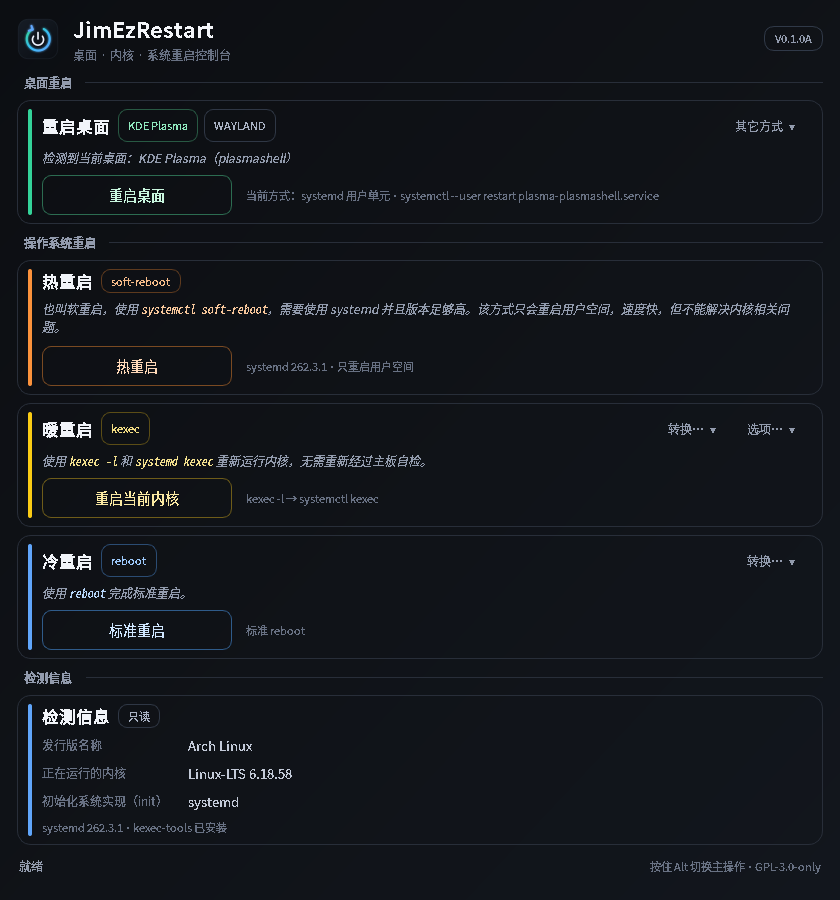

# JimEzRestart

> 桌面 · 内核 · 系统重启控制台

JimEzRestart 是一个面向 Arch Linux / systemd 桌面的图形化重启工具：可以重启桌面、
热重启用户空间、通过 kexec 重启当前内核或切换内核，以及执行标准重启和 SysRq 硬重启。
所有危险操作都需要确认，硬重启还带 5 秒倒计时。



当前版本：`V0.1.0A`（打包版本 `0.1.0-5`）

## 功能

- **重启桌面**：优先使用 systemd 用户单元（KDE 为 `plasma-plasmashell.service`），
  也可以退回到直接命令；“其它方式”菜单只显示与当前主按钮不同的方式；自动检测 KDE Plasma、
  GNOME、Xfce、Cinnamon、MATE、Sway、Hyprland。
- **热重启**：`systemctl soft-reboot`，只重启用户空间，需要 systemd 254 或更高。
- **暖重启**：`kexec -l` 载入内核，再由 `systemctl kexec` 启动；默认重新运行当前内核。
- **切换内核**：从 `/usr/lib/modules` 枚举已安装的内核，用 kexec 直接切换，不经过
  主板自检。没有其它内核时会提示用包管理器安装。
- **原生 kexec**：可选的 `kexec -e` 路径，绕过 systemd；在“选项…”菜单中启用，
  默认关闭并明确警告。
- **冷重启**：标准 `reboot`；按住 Alt 或从菜单切换到硬重启时，通过
  `/proc/sysrq-trigger` 强制重启。
- **检测信息**：发行版、当前内核、具体的 init 实现（systemd、OpenRC、runit、
  s6、dinit、GNU Shepherd、SysV/BusyBox init 等；无法识别时显示“未知”），
  以及 systemd 版本、kexec-tools、lockdown 状态。
- **菜单与复选框**：“其它方式”和“转换…”菜单只显示与当前主按钮不同的选项，避免重复；
  这些选择项是普通菜单按钮，不显示复选框；只有“选项…”里的原生 kexec 是复选框。
- **状态栏**：结果或错误提示显示 6 秒后自动回到“就绪”；正在执行的操作不会被
  该计时器清掉。
- 不可用的功能会置灰，鼠标悬停可看到具体原因（例如没有 systemd、没有
  kexec-tools、没有 pkexec、内核 lockdown、缺少 initramfs）。

## 键盘操作

界面完全可以用键盘操作，无需鼠标：

| 按键 | 作用 |
| --- | --- |
| `Tab` / `Shift+Tab` | 按视觉顺序在菜单与按钮之间移动焦点（菜单 → 主按钮，从上到下逐张卡片） |
| `空格` | 触发当前焦点按钮；在菜单按钮上打开菜单 |
| `↑` / `↓` | 在打开的菜单里选择项目；在内核选择弹窗里切换内核 |
| `Enter` | 确认弹窗里的默认按钮 |
| `Esc` | 关闭菜单或取消弹窗 |
| 按住 `Alt` | 主按钮临时切换到第二种动作（见下表） |

获得焦点的控件会用彩色描边高亮，颜色与该卡片的主题色一致。窗口高度不足时，
焦点移动到下方控件会自动滚动到可见位置。所有按钮与复选框都带有无障碍名称，
屏幕阅读器可以读出它们的文字与作用。

## Alt 行为

主按钮有两个动作。不按 Alt 时执行默认动作，按住 Alt 时执行第二动作；卡片上的
“转换…”菜单始终可以手动选择，不受 Alt 影响；菜单只列出与当前主按钮不同的选项，
选中后主按钮切换过去，菜单则改为显示可以切回来的另一项。

| 卡片 | 默认（不按 Alt） | 按住 Alt |
| --- | --- | --- |
| 重启桌面 | 以 systemd 用户单元重启 | 以命令重启 |
| 暖重启 | 重启当前内核 | 切换操作系统内核 |
| 冷重启 | 标准重启 | 硬重启 |

## 安装

从本仓库构建出的安装包可以直接安装：

```bash
sudo pacman -U jimezrestart-0.1.0-5-any.pkg.tar.zst
```

安装后从应用菜单启动 “JimEzRestart”，或运行：

```bash
jimezrestart
```

运行时依赖：`python`、`python-pyqt6`、`polkit`（提供 `pkexec`）、`systemd`。
`kexec-tools` 是暖重启和切换内核的可选依赖；没有它时相关按钮会置灰。

## 从源码构建

需要 `base-devel`、`python`、`python-pyqt6`、`fakeroot`、`pacman`：

```bash
cd packaging
./build.sh
```

脚本会从当前工作树生成 `jimezrestart-0.1.0.tar.gz`，然后调用 `makepkg`，产物位于
`packaging/jimezrestart-0.1.0-5-any.pkg.tar.zst`。开发模式可以直接运行：

```bash
PYTHONPATH=src python3 -m jimezrestart
PYTHONPATH=src python3 -m jimezrestart --demo   # 使用演示数据，不执行任何操作
```

## 工作原理与安全边界

GUI 本身**不以 root 运行**。需要特权的操作统一交给固定的助手脚本：

```text
pkexec /usr/lib/jimezrestart/jimezrestart-helper <action> [--kernel ... --initrd ...]
```

助手只接受 `soft-reboot`、`kexec-load`、`kexec-native`、`reboot`、`hard-reboot`
这几个动作，并会再次检查：

- 调用者 uid 为 0（由 pkexec 提权）；
- kexec 路径的内核必须位于 `/usr/lib/modules/*/vmlinuz`，initramfs 必须位于
  `/boot/initramfs-*.img`，并且是真实的可读普通文件；
- kernel lockdown 开启时拒绝 kexec；
- `soft-reboot` 要求 systemd 版本不低于 254；
- 硬重启前确认 `/proc/sysrq-trigger` 可用。

桌面重启是用户级操作，不需要提权：systemd 单元通过
`systemctl --user restart`，命令方式直接启动桌面进程。

## 已知限制

- 硬重启不会等待文件系统同步，**可能损坏未落盘的数据或文件系统**；只有标准重启
  也无效时才使用。
- 原生 kexec 在部分固件、显卡驱动或加密磁盘环境下可能黑屏、卡死或无法启动。
- 没有 systemd 时，热重启和 systemd 单元重启不可用；可以勾选“使用原生 kexec”
  让暖重启走 `kexec -e`。
- 没有 `kexec-tools` 时，暖重启、切换内核和原生 kexec 都不可用。
- 内核 lockdown 开启时，kexec 被内核禁止。
- 切换内核会终止当前会话，请先保存工作。

## 开发与测试

```bash
PYTHONPATH=src QT_QPA_PLATFORM=offscreen python3 -m unittest discover -s tests -v
```

测试覆盖系统/桌面检测、具体 init 名称、内核枚举、特权参数校验、Alt 文案切换、
普通菜单按钮、菜单去重、键盘焦点顺序、焦点跟随滚动、禁用原因、硬重启倒计时、
内核选择弹窗和状态栏复位，共 58 项。

重新生成 README 截图（演示数据，不会执行操作）：

```bash
PYTHONPATH=src QT_QPA_PLATFORM=offscreen python3 scripts/screenshot.py
```

## 目录结构

```text
src/jimezrestart/       Python 源码（PyQt6 GUI + 纯 stdlib 检测层）
helper/                 由 pkexec 调用的固定特权助手
data/                   desktop 文件、AppStream 元数据、SVG 图标
packaging/              PKGBUILD、启动器、构建脚本
tests/                  unittest 测试
screenshots/            README 截图
scripts/screenshot.py   离屏截图工具
```

## 许可证

GPL-3.0-only。完整文本见 [LICENSE](LICENSE)。
